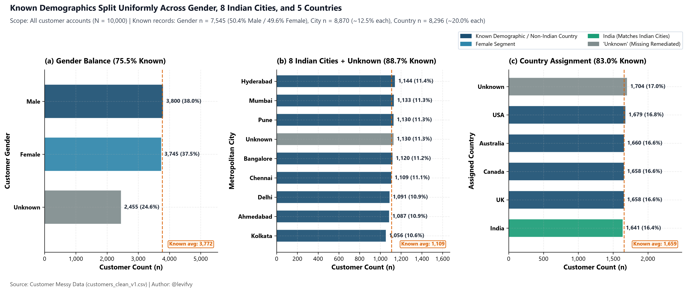
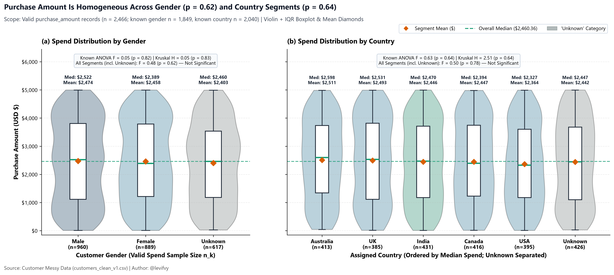
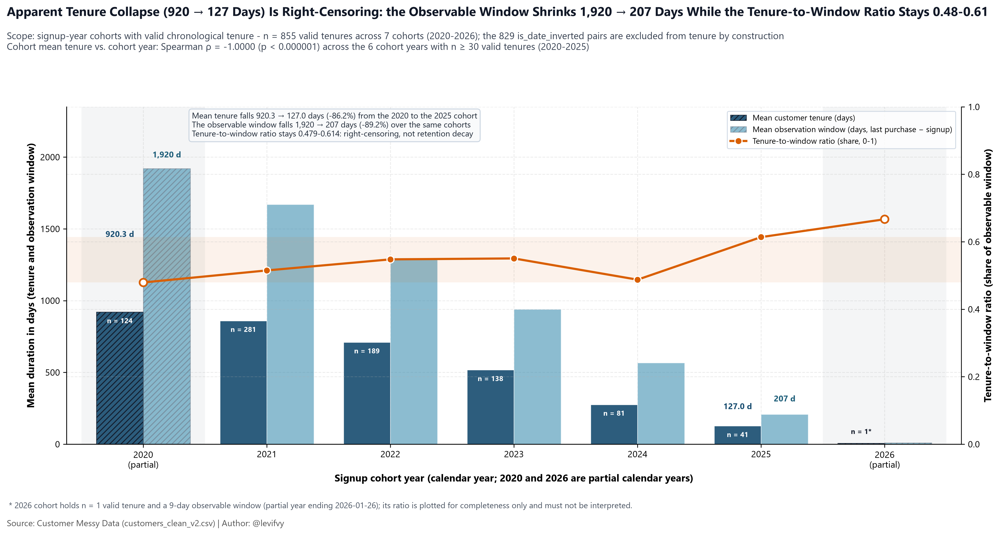

# Executive Report

**Customer Messy Data — 10,000 retail accounts, cleaned and analysed. Report date: 8 November 2026.**

## 1. Bottom Line

- **Revenue sits in a minority of orders.** Of 2,466 verified orders (24.7% of accounts), the 724 above $3,500 (29.4%) hold **$3,057,314 — 50.6% of $6,043,218** verified spend (KPI-2).
- **Contactability, not demographics, is the binding constraint.** 5,612 accounts (56.1%) have no valid email or phone and hold **$3,388,004 (56.1%)** of verified revenue; 405 of the 724 high-value customers (55.9%) are among them (**$1,713,463**, 28.4%).
- **Segment targeting is unsupported.** Average spend does not differ by age, gender, city or country (one-way ANOVA, a test comparing group averages; all p ≥ 0.4752), and across 14 variable pairs the largest association is |r| = 0.13, none significant (smallest p = 0.0662).

## 2. Data We Could Trust

All 10,000 rows and 12 columns were kept. Coverage is uneven: age 24.7% (n = 2,465), order value 24.7% (n = 2,466), feedback 50.5% (n = 5,049), city 88.7% (n = 8,870) — KPI-1. The rest were blanks or placeholder codes (`-5`/`200` in age, `-999`/`"N/A"` in spend), marked "unknown" rather than filled with an average that would have halved the spread of both variables (spend SD $1,443 → $716). Missingness looks random (Welch t-test p = 0.6964; Mann-Whitney p = 0.6855), so the valid subset reads as representative. Three defects limit the data: 2,521 of 5,049 ratings (49.9%) sit on an off-scale "10", so satisfaction is reported on the 1–5 scale only; 5,888 of 7,348 records with both city and country known (80.1%) pair an Indian city with USA, Australia, Canada or UK, so country cannot be used; and 829 of 1,684 dual-date records (49.2%) show a purchase before signup, leaving 855 accounts (8.6%) with usable tenure.

## 3. Findings by Question

### Q1 — Demographics & Geography

- Age is known for n = 2,465 (24.7%): mean 43.7 years, median 43.0, standard deviation 15.3, range 18–70 — a broad adult base with no dominant band.
- Gender is known for 7,545 (75.5%) and is near-even: 3,800 male versus 3,745 female (50.4% / 49.6% of known).
- All eight known cities are Indian metros holding 1,056–1,144 accounts each, yet country is spread evenly across USA, Australia, Canada, UK and India; a chi-square test finds no relationship (χ² = 19.29, p = 0.8888, n = 7,348), the signature of a corrupted country field.

### Q2 — Revenue & High-Value Segments

- Verified spend totals $6,043,218 across n = 2,466 orders (24.7%): mean $2,451, median $2,460, SD $1,443 (KPI-2).
- Value is tiered: 724 High orders (29.4% of valid orders) generate $3,057,314 (50.6%), 1,105 Medium orders (44.8%) generate $2,602,999 (43.1%), and 637 Low orders (25.8%) generate $382,906 (6.3%).
- Average spend is flat by segment (ANOVA: gender p = 0.8161, country p = 0.6413, city p = 0.4752, age group p = 0.6798). Across 14 pairs the strongest association is age × tenure, |r| = 0.13 (n = 206, p = 0.0704); none is significant (smallest p = 0.0662), and at n = 206 only associations near 0.2 are detectable, so this is "nothing detectable at these sample sizes", not proven independence.

### Q3 — Satisfaction, Retention & Reachability

- On the clean scale, n = 2,528 ratings of 1–5 average 2.96 (median 3.0), with 1,027 Detractors (40.6%) against 945 Promoters (37.4%); the 2,521 "10" ratings (49.9% of valid) are excluded as off-scale (KPI-6).
- Only 4,388 accounts (43.9%) have one valid contact channel and 634 (6.3%) have both; the 5,612 unreachable accounts (56.1%) hold $3,388,004 — 56.1% of verified revenue, including 405 of 724 high-value customers ($1,713,463; KPI-4).
- Tenure is not a retention signal: median is 638 days (n = 855, 8.6%), and cohort mean tenure falls from 920.3 days (2020, n = 124) to 127.0 (2025, n = 41; Spearman ρ = −1.00, a rank-trend test; p < 0.000001) while the observation window shrinks 1,920 → 207 days and the observed-to-window ratio stays flat at 0.479–0.614. That is right-censoring — recent customers had less time to buy — not evidence of faster churn.

## 4. Recommendations

| # | Recommendation | Owner | Tied finding | Expected effect |
|---|---|---|---|---|
| 1 | Value-tier programme for orders above $3,500 | Marketing | Q2: 50.6% of revenue | Protects $3.06M already in the book |
| 2 | Require valid email and 10-digit phone at checkout and login | CRM | Q3: 56.1% unreachable | Makes up to $3.39M addressable |
| 3 | Hand-recover the 405 unreachable high-value customers | CRM | Q3: $1.71M; 22.4% Detractors vs 15.9% Promoters (n = 201) | Puts $1,713,463 of top-tier revenue back in contact |
| 4 | Report on city, not country; add a city-to-country lookup | Data team | Q1: 80.1% contradiction | Removes a market-sizing defect |
| 5 | Unify the survey on one 1–5 scale | Data team | Q3: 49.9% off-scale | Converts half of feedback into signal |
| 6 | Move budget out of demographic targeting | Marketing | Q2: all tests p ≥ 0.4752 | Avoids spend on undetectable differences |

## 5. Limitations

- **Coverage bias.** Age and spend exist for about one in four accounts; every such statement describes the valid subset, whose representativeness rests on the missingness tests (p = 0.6964, p = 0.6855), not on proof.
- **Observational only.** All associations are observed, not experimental; no causal claim is made.
- **Tenure covers 8.6%.** Valid tenure is n = 855; cohort trends are right-censored, 2020 and 2026 are partial years, and the 2026 cohort (58 signups, one valid tenure) is not interpretable.
- **Limited power.** At n = 206, only associations near 0.2 or stronger are detectable; no detected pattern is not proof of independence.
- **Satisfaction unresolved.** 49.9% of ratings are off-scale and 49.5% of accounts unrated, so sentiment rests on a small, possibly self-selected minority.

## Appendix — Evidence Map

| Claim | Source |
|---|---|
| Coverage 24.7% / 24.7% / 50.5% / 88.7% | `e6_research_questions_kpis.csv` (KPI-1); `specs/ontology.md` §4 |
| Spend $6,043,218; mean $2,451; median $2,460 | `e6_research_questions_kpis.csv` (KPI-2) |
| Tier split 724 / 1,105 / 637 orders | `m4_engineered_features_summary.csv` |
| Segment p-values; geo mismatch 5,888 of 7,348 (p = 0.8888) | `e5_bivariate_hypothesis_tests.csv` |
| \|r\| = 0.13 (n = 206); 14 pairs; smallest p = 0.0662 | `m5_correlation_highlights.csv`; `m5_correlation_pairwise_tests.csv`; chart `assets/charts/m5_correlation_heatmap.png` |
| Detectable effect near 0.2 at n = 206 | `handoffs/m5_statistical-analyst.md` (Open Issues) |
| Reachability 4,388; 634; 5,612; $3,388,004 | `e6_research_questions_kpis.csv` (KPI-4); `m4_engineered_features_summary.csv` |
| 405 of 724 VIPs unreachable; $1,713,463; 22.4% vs 15.9% (n = 201) | `m3_pivot_reachability_spend_tier.csv` |
| Likert n = 2,528; mean 2.96; 1,027 (40.6%) vs 945 (37.4%) | `e6_research_questions_kpis.csv` (KPI-6); `handoffs/e6_statistical-analyst.md` |
| Tenure 638 days; 829 of 1,684 inverted; 920.3 → 127.0; window 1,920 → 207 | `e6_research_questions_kpis.csv` (KPI-5); `m6_cohort_evolution_summary.csv`; `m6_trend_tests.csv` |
| Flat acquisition (57–106/month, p = 0.6271) | `m6_trend_tests.csv`; `handoffs/m6_statistical-analyst.md`; chart `assets/charts/m6_signup_and_activity_trends.png` |
| Random missingness (p = 0.6964 / 0.6855); SD $1,443 → $716 | `m1_imputation_variance_impact.csv` |
