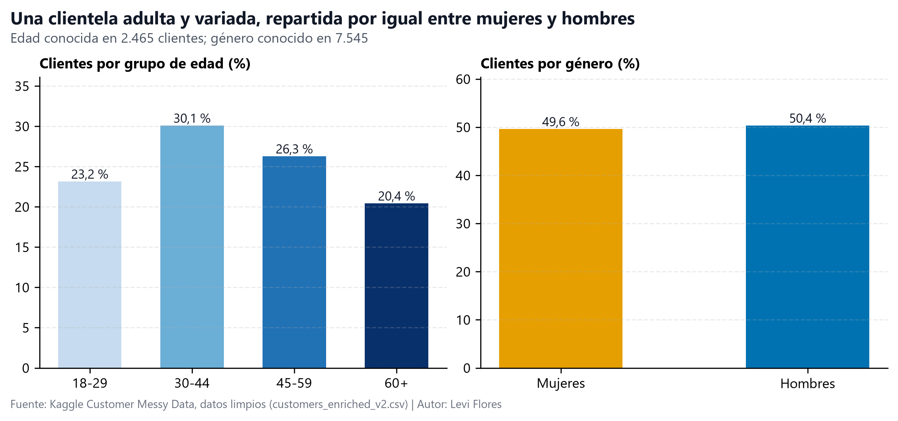
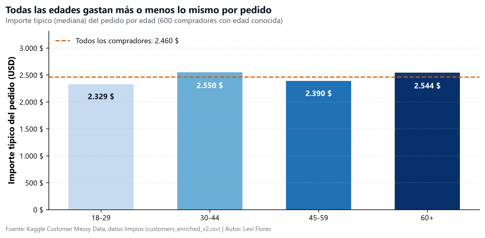
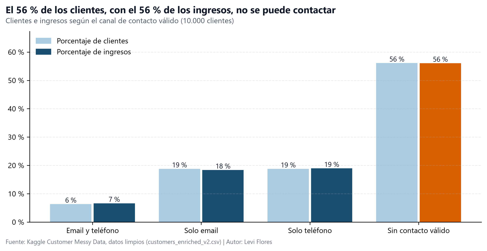

# Informe ejecutivo

**Customer Messy Data: 10.000 cuentas de clientes, limpiadas y analizadas. Fecha del informe: 8 de noviembre de 2026.** *Versión en español de `executive_report.md`; gráficos `assets/charts/x5_story_*_es.png`.*

## 1. Lo esencial

- **Los ingresos se concentran en una minoría de pedidos.** De los 2.466 pedidos verificados (24,7 % de las cuentas), los 724 de más de 3.500 $ (29,4 %) suman **3.057.314 $, el 50,6 % de los 6.043.218 $** de gasto verificado (KPI-2).
- **El límite real es poder contactar, no el perfil demográfico.** 5.612 cuentas (56,1 %) no tienen ni correo ni teléfono válidos y concentran **3.388.004 $ (56,1 %)** de los ingresos verificados; 405 de los 724 clientes de alto valor (55,9 %) están entre ellas (**1.713.463 $**, 28,4 %).
- **Segmentar por perfil no tiene respaldo.** El gasto medio no cambia con la edad, el género, la ciudad ni el país (prueba ANOVA, que compara las medias de los grupos; todos los p ≥ 0,4752, es decir, diferencias atribuibles al azar), y entre 14 pares de variables la relación más fuerte es |r| = 0,13 (escala de 0 a 1), ninguna significativa (p mínimo = 0,0662).

## 2. Los datos en los que podemos confiar

Se conservaron las 10.000 filas y las 12 columnas. La cobertura es desigual: edad 24,7 % (n = 2.465), importe del pedido 24,7 % (n = 2.466), valoración 50,5 % (n = 5.049), ciudad 88,7 % (n = 8.870), KPI-1. El resto eran huecos o códigos de relleno (`-5`/`200` en la edad, `-999`/`"N/A"` en el gasto), que se marcaron como «desconocidos» en lugar de rellenarlos con una media que habría reducido a la mitad la dispersión de ambas variables (desviación del gasto: 1.443 $ → 716 $). Los huecos parecen aleatorios (pruebas de Welch p = 0,6964 y Mann-Whitney p = 0,6855), así que la parte válida parece representativa. Tres defectos limitan los datos: 2.521 de 5.049 valoraciones (49,9 %) son un «10» fuera de escala, por lo que la satisfacción solo se mide en la escala 1-5; 5.888 de 7.348 registros con ciudad y país (80,1 %) combinan una ciudad india con EE. UU., Australia, Canadá o Reino Unido, por lo que el país no se puede usar; y 829 de 1.684 registros con dos fechas (49,2 %) tienen una compra anterior al alta, lo que deja 855 cuentas (8,6 %) con antigüedad utilizable.

## 3. Resultados por pregunta

### P1: Perfil demográfico y geografía

- La edad se conoce en n = 2.465 (24,7 %): media 43,7 años, mediana 43,0, desviación típica 15,3, rango 18-70; una base adulta amplia sin una franja dominante.
- El género se conoce en 7.545 (75,5 %) y está casi equilibrado: 3.800 hombres frente a 3.745 mujeres (50,4 % / 49,6 % de los conocidos).
- Las ocho ciudades conocidas son metrópolis indias con entre 1.056 y 1.144 cuentas cada una, pero el país se reparte por igual entre EE. UU., Australia, Canadá, Reino Unido e India; una prueba chi-cuadrado no encuentra relación (χ² = 19,29, p = 0,8888, n = 7.348), la huella de un campo de país corrupto.

### P2: Ingresos y segmentos de alto valor

- El gasto verificado suma 6.043.218 $ en n = 2.466 pedidos (24,7 %): media 2.451 $, mediana 2.460 $, desviación típica 1.443 $ (KPI-2).
- El valor está escalonado: 724 pedidos altos (29,4 % de los pedidos válidos) generan 3.057.314 $ (50,6 %), 1.105 medios (44,8 %) generan 2.602.999 $ (43,1 %) y 637 bajos (25,8 %) generan 382.906 $ (6,3 %).
- El gasto medio es plano por segmento (ANOVA: género p = 0,8161, país p = 0,6413, ciudad p = 0,4752, grupo de edad p = 0,6798). En 14 pares, la relación más fuerte es edad × antigüedad, |r| = 0,13 (n = 206, p = 0,0704); ninguna es significativa (p mínimo = 0,0662), y con n = 206 solo se detectan relaciones cercanas a 0,2, así que la lectura es «nada detectable con este tamaño de muestra», no una independencia demostrada.

### P3: Satisfacción, retención y contactabilidad

- En la escala limpia, n = 2.528 valoraciones de 1 a 5 tienen una media de 2,96 (mediana 3,0), con 1.027 detractores (40,6 %) frente a 945 promotores (37,4 %); los 2.521 «10» (49,9 % de las válidas) se excluyen por estar fuera de escala (KPI-6).
- Solo 4.388 cuentas (43,9 %) tienen al menos un canal de contacto válido y solo 634 (6,3 %) tienen los dos; las 5.612 cuentas inalcanzables (56,1 %) concentran 3.388.004 $, el 56,1 % de los ingresos verificados, incluidos 405 de los 724 clientes de alto valor (1.713.463 $; KPI-4).
- La antigüedad no es una señal de retención: la mediana es de 638 días (n = 855, 8,6 %) y la antigüedad media por cohorte baja de 920,3 días (2020, n = 124) a 127,0 (2025, n = 41; ρ de Spearman = −1,00, una prueba de tendencia por rangos; p < 0,000001), mientras la ventana de observación se reduce de 1.920 a 207 días y la proporción observada/ventana se mantiene estable entre 0,479 y 0,614. Es censura por la derecha (los clientes recientes han tenido menos tiempo para comprar), no una prueba de abandono más rápido.

## 4. Recomendaciones

| # | Recomendación | Responsable | Hallazgo asociado | Efecto esperado |
|---|---|---|---|---|
| 1 | Programa por nivel de valor para pedidos de más de 3.500 $ | Marketing | P2: 50,6 % de los ingresos | Protege los 3,06 M$ ya facturados |
| 2 | Exigir correo válido y teléfono de 10 dígitos en el pago y el inicio de sesión | CRM | P3: 56,1 % inalcanzables | Hasta 3,39 M$ vuelven a ser contactables |
| 3 | Recuperar uno a uno a los 405 clientes de alto valor inalcanzables | CRM | P3: 1,71 M$; 22,4 % detractores frente a 15,9 % promotores (n = 201) | Recupera el contacto con 1.713.463 $ de ingresos de primer nivel |
| 4 | Informar por ciudad, no por país; añadir una tabla ciudad-país | Equipo de datos | P1: 80,1 % de contradicciones | Elimina un error al dimensionar mercados |
| 5 | Unificar la encuesta en una sola escala de 1 a 5 | Equipo de datos | P3: 49,9 % fuera de escala | Convierte la mitad de las opiniones en información útil |
| 6 | Sacar presupuesto de la segmentación demográfica | Marketing | P2: todas las pruebas p ≥ 0,4752 | Evita gastar en diferencias que no existen |

## 5. Limitaciones

- **Sesgo de cobertura.** La edad y el gasto existen para una de cada cuatro cuentas; cada afirmación describe la parte válida, cuya representatividad se apoya en las pruebas de huecos aleatorios (p = 0,6964, p = 0,6855), no en una demostración.
- **Solo observacional.** Todas las relaciones son observadas, no experimentales; no se afirma ninguna causa.
- **La antigüedad cubre el 8,6 %.** La antigüedad válida es n = 855; las tendencias por cohorte están censuradas por la derecha, 2020 y 2026 son años parciales y la cohorte de 2026 (58 altas, una antigüedad válida) no es interpretable.
- **Potencia limitada.** Con n = 206 solo se detectan relaciones cercanas a 0,2 o más fuertes; no detectar un patrón no demuestra que no exista.
- **Satisfacción sin resolver.** El 49,9 % de las valoraciones está fuera de escala y el 49,5 % de las cuentas no tiene valoración, así que la opinión descansa en una minoría pequeña y posiblemente autoseleccionada.

## Anexo: mapa de evidencias

| Afirmación | Fuente |
|---|---|
| Cobertura 24,7 % / 24,7 % / 50,5 % / 88,7 % | `e6_research_questions_kpis.csv` (KPI-1); `specs/ontology.md` §4 |
| Gasto 6.043.218 $; media 2.451 $; mediana 2.460 $ | `e6_research_questions_kpis.csv` (KPI-2) |
| Reparto por nivel 724 / 1.105 / 637 pedidos | `m4_engineered_features_summary.csv` |
| p-valores por segmento; desajuste geográfico 5.888 de 7.348 (p = 0,8888) | `e5_bivariate_hypothesis_tests.csv` |
| \|r\| = 0,13 (n = 206); 14 pares; p mínimo = 0,0662 | `m5_correlation_highlights.csv`; `m5_correlation_pairwise_tests.csv`; gráfico `assets/charts/m5_correlation_heatmap.png` |
| Efecto detectable cercano a 0,2 con n = 206 | `handoffs/m5_statistical-analyst.md` (Open Issues) |
| Contactabilidad 4.388; 634; 5.612; 3.388.004 $ | `e6_research_questions_kpis.csv` (KPI-4); `m4_engineered_features_summary.csv` |
| 405 de 724 clientes de alto valor inalcanzables; 1.713.463 $; 22,4 % frente a 15,9 % (n = 201) | `m3_pivot_reachability_spend_tier.csv` |
| Escala 1-5 n = 2.528; media 2,96; 1.027 (40,6 %) frente a 945 (37,4 %) | `e6_research_questions_kpis.csv` (KPI-6); `handoffs/e6_statistical-analyst.md` |
| Antigüedad 638 días; 829 de 1.684 invertidas; 920,3 → 127,0; ventana 1.920 → 207 | `e6_research_questions_kpis.csv` (KPI-5); `m6_cohort_evolution_summary.csv`; `m6_trend_tests.csv` |
| Captación estable (57-106 al mes, p = 0,6271) | `m6_trend_tests.csv`; `handoffs/m6_statistical-analyst.md`; gráfico `assets/charts/m6_signup_and_activity_trends.png` |
| Huecos aleatorios (p = 0,6964 / 0,6855); desviación 1.443 $ → 716 $ | `m1_imputation_variance_impact.csv` |
