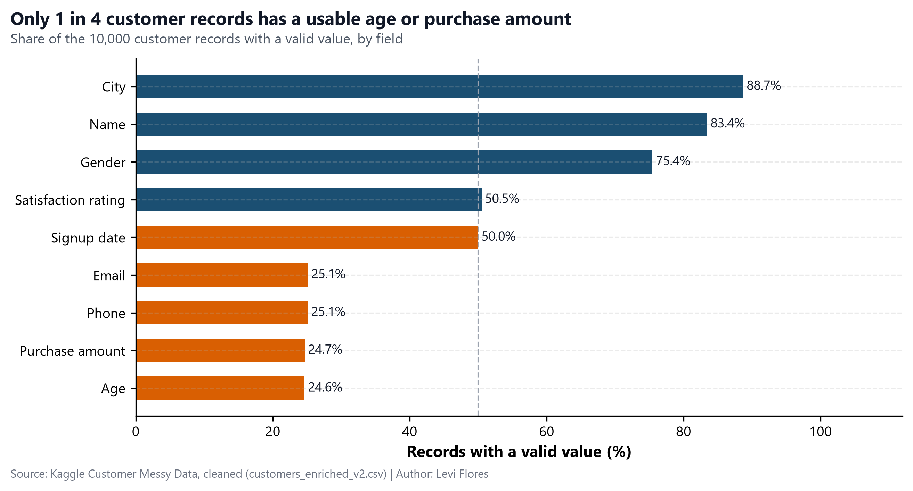
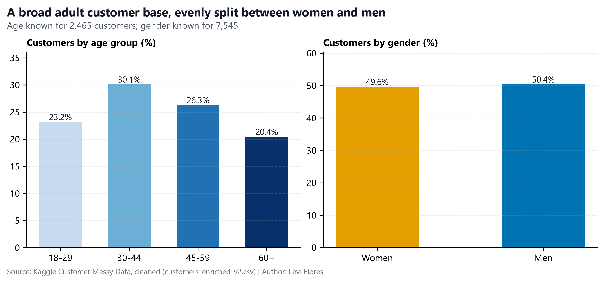
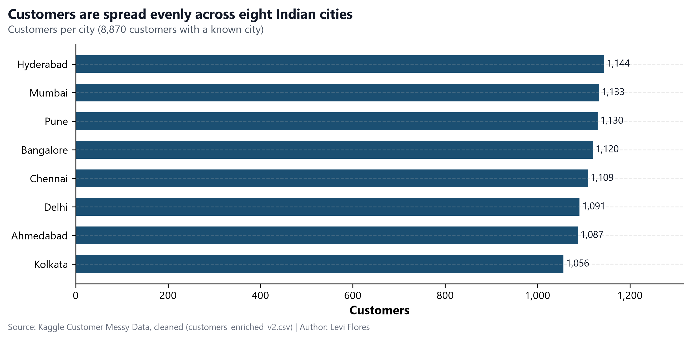
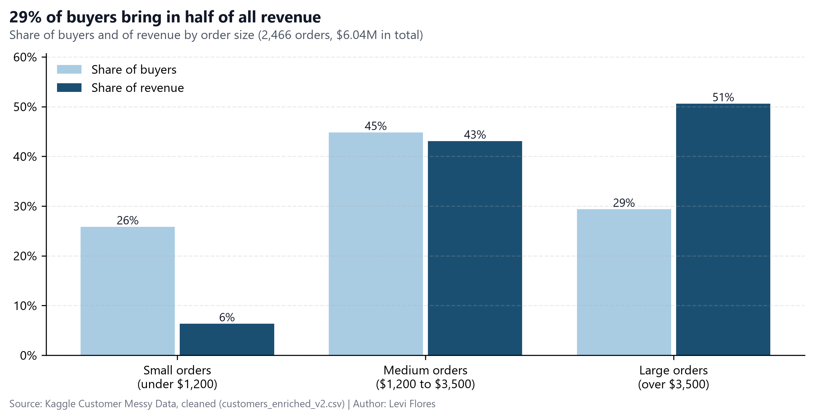
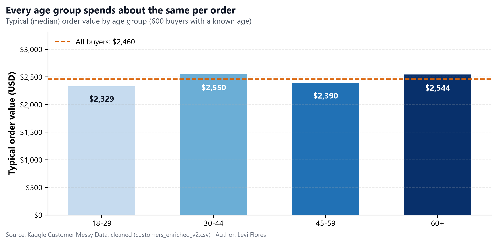
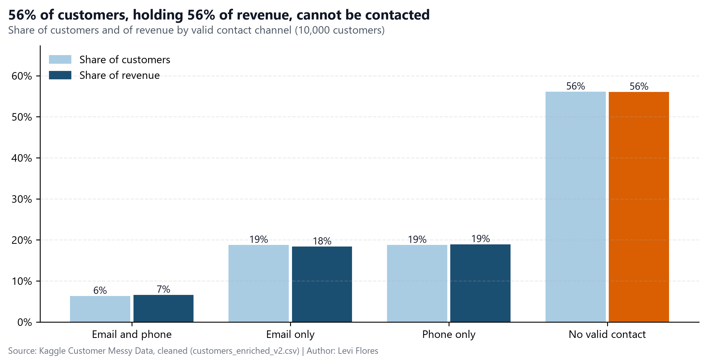
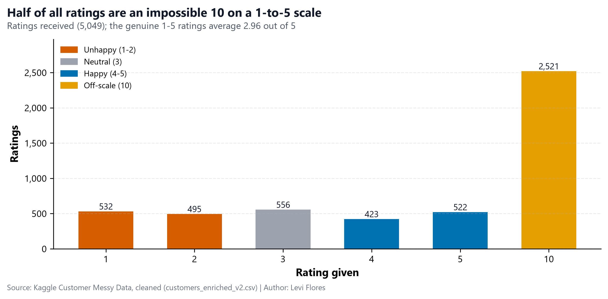

Executive Report · Customer Data Review

<h1>Behind the 10,000: What Our Customer Data Really Tells Us</h1>

A plain-language story of who our customers are, where the money comes from, and why half of them are out of reach

Levi Flores P1 IA School BCN · Exploratory Data Analysis project 9 November 2026

# A note before we start

This report is written for people who make decisions, not for data specialists. You will not find formulas or code here, only what the data says, how sure we are of it, and what we suggest doing about it.

We were handed a database of **10,000 customer accounts** and one clear request: *show us clean data, with meaning, and something we can act on*. We cleaned every record, checked every number twice, and turned the results into the story that follows. Every figure in this report can be traced back to the project's notebook and data tables, and you can explore all of it yourself in the interactive dashboard: **[eda-customer-messy-data.streamlit.app](https://eda-customer-messy-data.streamlit.app)**.

> **How to read the numbers.** When we say "typical order", we mean the **median**: line up all orders from smallest to largest and take the one in the middle. Unlike the average, a few very large or very small orders cannot distort it. When a difference is "too small to matter", it means it is the kind of gap that could appear by pure chance.

## 1. The starting point: a filing cabinet full of gaps

Imagine opening a filing cabinet with 10,000 customer cards and finding that many of them were filled in carelessly. That is what we found. About **4 in every 10 boxes** on those cards were empty or held a placeholder instead of a real answer: ages of *-5* or *200*, purchases recorded as *-999* or *"N/A"*, phone numbers such as *"abc123"*, emails without an *@*.

The consequence is simple but important: **we only know the age of one customer in four, and the purchase amount of one customer in four.** Cities and names are mostly complete; contact details are not.

We made one deliberate choice here. We did **not** fill the gaps with averages to make the tables look complete. Doing so would have invented thousands of identical "average customers" and hidden how different real customers are. Instead, every figure in this report is calculated only on the information that is genuinely there, and we always say how many customers it covers.

We also found two contradictions that tell us where the data cannot be trusted:

- **Country does not match city.** All eight cities in the database are in India, yet 5,888 of the 7,348 records that have both a city and a country (80%) list the USA, the UK, Canada or Australia as the country. We therefore use the **city**, not the country, to describe where customers live.
- **Purchases before signing up.** In 829 of the 1,684 accounts that have both dates, the last purchase is dated *before* the customer signed up, which is impossible. Those dates are set aside.

## 2. Who are our customers?

Once the noise is removed, a clear and balanced picture appears.

- **A broad adult base.** Among the 2,465 customers whose age we know, ages run from 18 to 70, and the typical customer is **43 years old**. No age group dominates: the largest group, people aged 30 to 44, is still under a third of the total.
- **Women and men in equal measure.** Among the 7,545 customers with a recorded gender, **49.6% are women and 50.4% are men.**

Geographically, the business is just as balanced.

Our customers live in **eight large Indian cities**, and each one holds between 1,056 and 1,144 customers. There is no "home market" that carries the business and no city that is being left behind. In short: **we serve a wide, even, urban adult audience.**

## 3. Where does the money come from?

The 2,466 customers with a verified purchase spent **$6.04 million** in total. The typical order is worth **$2,460**, and orders range from about $10 to $5,000. But the money is not spread evenly.

> **The key fact:** the **724 customers who place large orders (over $3,500) are only 29% of buyers, yet they bring in 51% of all revenue**, about $3.06 million. At the other end, small orders (under $1,200) come from a quarter of buyers but add up to just 6% of revenue.

The natural next question is: *who are these big spenders?* Are they older, wealthier-looking customers, or concentrated in one city? The answer surprised us.

**Every age group spends about the same per order.** The typical order sits between $2,330 and $2,550 whatever the customer's age, and we found the same flat pattern for women and men and across all eight cities. These gaps are too small to matter: they could easily appear by chance.

This is a valuable negative result. It tells us that **age, gender and city do not predict how much a customer will spend.** Campaigns aimed at a particular age or city are unlikely to find customers who spend more. What does identify our most valuable customers is simpler: **the size of the orders they already place.**

## 4. Can we reach them?

A customer we cannot contact is a customer we cannot thank, retain or bring back. This is where the story turns serious.

- **56% of our customers (5,612 people) have neither a working email nor a valid phone number.** We have no way to reach them.
- Those same unreachable customers account for **56% of verified revenue, about $3.39 million.**
- Only **634 customers (6%)** can be reached by both email and phone.
- Most worrying: **405 of the 724 large-order customers** are among the unreachable. Together they represent **$1.71 million** of our most valuable revenue, and today we cannot send them a single message.

The placeholder values suggest that this is mostly a data-capture problem rather than customers refusing to share their details: phone numbers were stored as *"0"* or *"abc123"*, and emails were saved without the *@*. In other words, **this is a problem we can fix at the source.**

## 5. Are they happy?

Customer ratings should be our early-warning signal. Instead, they revealed another data problem.

The survey asks customers to rate us from **1 to 5**. Yet **half of all ratings (2,521 of 5,049) are a 10**, a score that does not exist on that scale. The most likely explanation is a survey set up with two different scales at the same time; this should be confirmed with whoever runs the survey. Until then, those 10s cannot be read as "very happy" customers.

Looking only at the genuine 1-to-5 ratings, the picture is **lukewarm**: the average is **2.96 out of 5**, with slightly more unhappy customers (41% gave 1 or 2) than happy ones (37% gave 4 or 5).

How long do customers stay with us? Only 855 accounts have two valid, correctly ordered dates. For them, the typical time between signing up and the last purchase is **638 days, almost 21 months.** We do not read more into this figure: newer customers simply have not had as much time to buy again, so the data cannot yet tell us whether loyalty is improving or getting worse.

## 6. Conclusions

1. **The database is the first problem to solve.** Only one record in four has a usable age or purchase amount, the country field contradicts the city, and half of the satisfaction scores sit on an impossible scale. Every other decision depends on fixing how data is captured.
2. **We serve a broad and balanced audience.** Adults of every age, women and men in equal shares, spread evenly across eight Indian cities.
3. **Half of the revenue comes from fewer than a third of buyers.** The 724 customers who place large orders are the core of the business.
4. **Demographics do not predict spending.** Age, gender and city make no meaningful difference to order value; order size itself is the signal to follow.
5. **More than half of the customers, and more than half of the revenue, are out of reach.** This includes 405 of our most valuable customers, worth $1.71 million.
6. **We do not really know how satisfied customers are.** The genuine ratings are lukewarm, and half of the feedback is unusable until the survey is fixed.

## 7. What we recommend

| # | Action | Who | Why it matters | Expected result |
|---|---|---|---|---|
| 1 | Make a valid email and a 10-digit phone number mandatory at sign-up and checkout | CRM and web teams | 56% of customers cannot be contacted | Up to $3.39M of revenue becomes reachable again |
| 2 | Personally recover contact details for the 405 unreachable large-order customers | Customer service | They hold $1.71M of our best revenue | Our most valuable customers back in contact |
| 3 | Create a dedicated programme for customers with orders above $3,500 | Marketing | They bring in 51% of revenue | Protects $3.06M already earned |
| 4 | Stop targeting campaigns by age, gender or city; target by order size instead | Marketing | These groups spend the same | Budget goes where it can make a difference |
| 5 | Fix the satisfaction survey so it uses a single 1-to-5 scale | Data and CX teams | Half of the ratings are unusable | Twice as much reliable customer feedback |
| 6 | Record location with a city-to-country check | Data team | 80% of country values contradict the city | Reliable market sizing by country |

## 8. What this data cannot tell us

- **Representativeness.** Ages and purchase amounts exist for about a quarter of customers. Our checks suggest that the gaps fall at random, so this quarter looks like everyone else, but that is a reasonable assumption, not a certainty.
- **Cause and effect.** The data shows what happens together, not why it happens. We make no claim that one thing causes another.
- **Loyalty over time.** Too few accounts have reliable dates to measure whether customers stay longer or leave sooner than before.
- **True satisfaction.** With half of the scores off-scale and many customers never rating us, satisfaction rests on a minority who chose to answer.

## 9. Where to see more

- **Interactive dashboard**, to filter by city, age, gender, order size or contact channel: [eda-customer-messy-data.streamlit.app](https://eda-customer-messy-data.streamlit.app)
- **Two-page CEO report** with the detailed figures: `reports/executive_report.pdf` (English) and `reports/executive_report_es.pdf` (Spanish).
- **Data quality report**, explaining what was missing, what was fixed and why: `reports/data_quality_report.md`.
- **Full analysis**, step by step: `notebooks/01_eda_customers.ipynb` in the [project repository](https://github.com/IA-P1-BCN/ai_project_EDA_Levi_Flores).

*Source: Kaggle "Customer Messy Data" (10,000 records, 12 fields), cleaned and enriched in this project. All figures come from `data/processed/customers_enriched_v2.csv` and the summary tables in `data/processed/summaries/`.*
