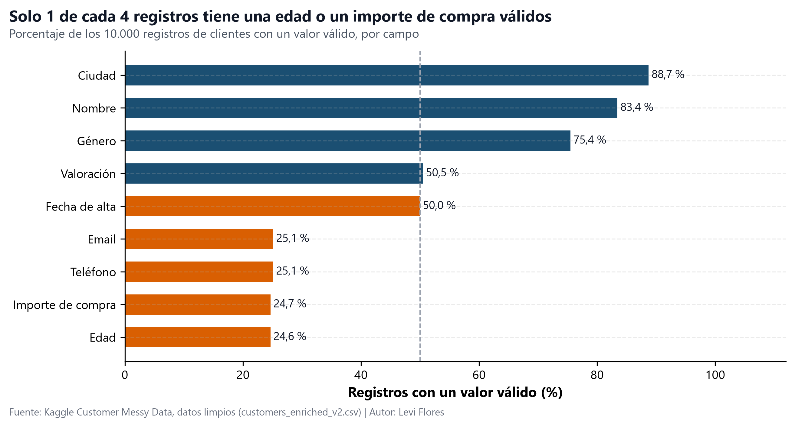
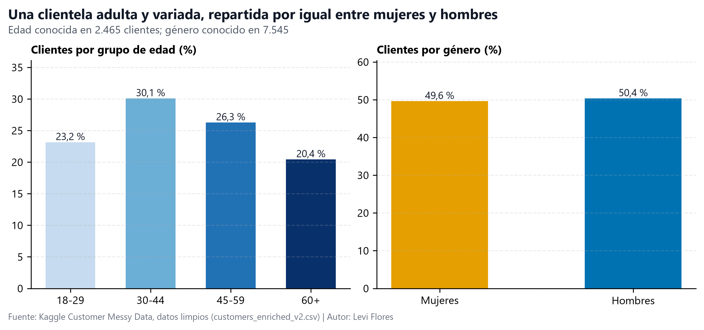
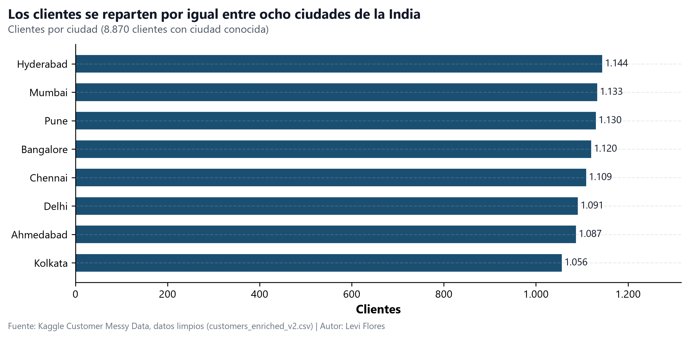
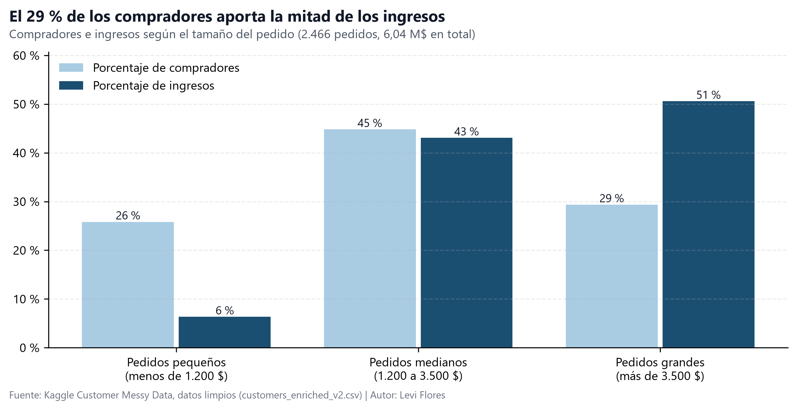
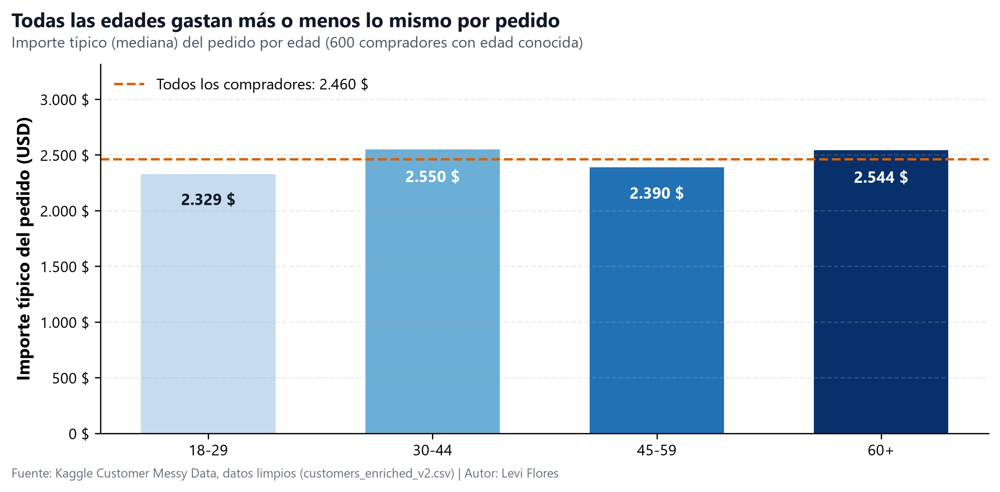
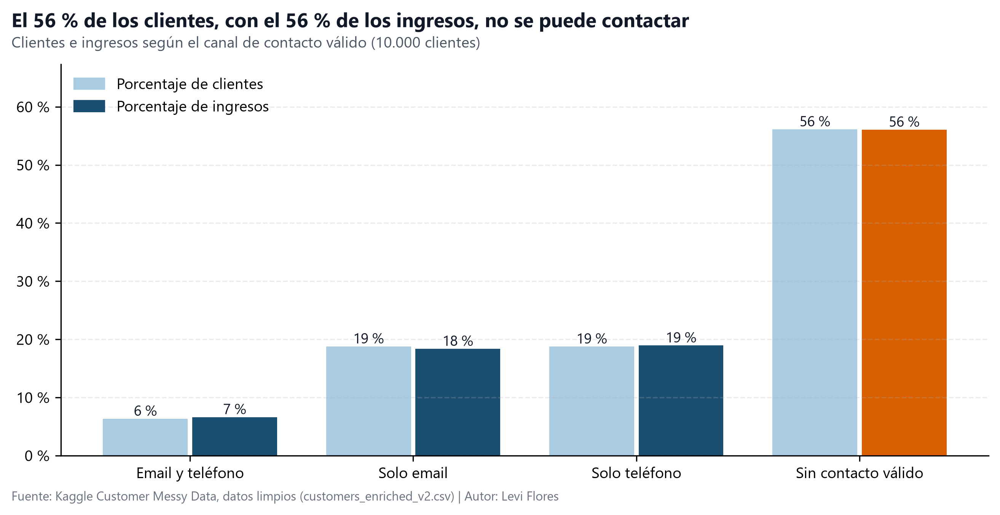
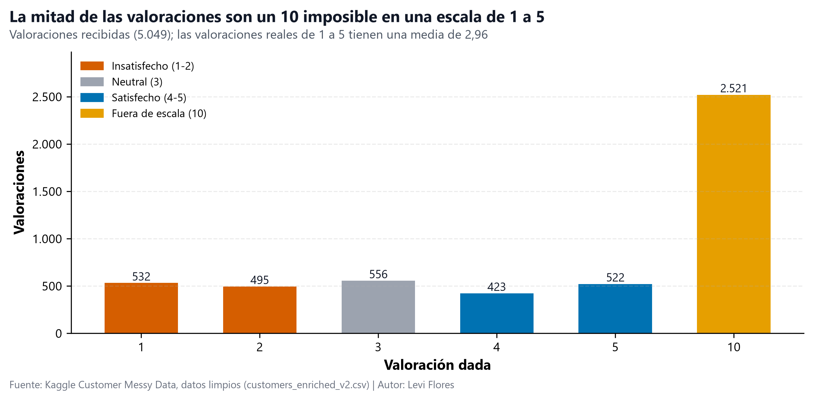

Informe ejecutivo · Revisión de los datos de clientes

<h1>Detrás de los 10.000: lo que de verdad cuentan los datos de nuestros clientes</h1>

Una historia en lenguaje sencillo sobre quiénes son nuestros clientes, de dónde vienen los ingresos y por qué no podemos contactar con la mitad de ellos

Levi Flores P1 IA School BCN · Proyecto de Análisis Exploratorio de Datos 9 de noviembre de 2026

# Antes de empezar

Este informe está escrito para quienes toman decisiones, no para especialistas en datos. Aquí no hay fórmulas ni código: solo lo que dicen los datos, hasta qué punto podemos fiarnos de ellos y qué proponemos hacer.

Recibimos una base de datos con **10.000 cuentas de clientes** y un encargo muy claro: *mostrarnos datos limpios, con sentido y algo sobre lo que podamos actuar*. Limpiamos cada registro, comprobamos cada cifra dos veces y convertimos los resultados en la historia que sigue. Todas las cifras de este informe se pueden rastrear hasta el notebook y las tablas del proyecto, y cualquiera puede explorarlas en el dashboard interactivo: **[eda-customer-messy-data.streamlit.app](https://eda-customer-messy-data.streamlit.app)**.

> **Cómo leer las cifras.** Cuando hablamos del «pedido típico» nos referimos a la **mediana**: si ordenamos todos los pedidos de menor a mayor, es el que queda justo en el medio. A diferencia de la media, unos pocos pedidos muy grandes o muy pequeños no la distorsionan. Cuando decimos que una diferencia es «demasiado pequeña para importar», queremos decir que es el tipo de diferencia que podría aparecer por pura casualidad.

## 1. El punto de partida: un archivador lleno de huecos

Imagine que abre un archivador con 10.000 fichas de clientes y descubre que muchas se rellenaron sin cuidado. Eso es lo que encontramos. Aproximadamente **4 de cada 10 casillas** de esas fichas estaban vacías o tenían un valor de relleno en lugar de una respuesta real: edades de *-5* o *200*, compras registradas como *-999* o *«N/A»*, teléfonos como *«abc123»* y correos sin *@*.

La consecuencia es sencilla pero importante: **solo conocemos la edad de uno de cada cuatro clientes, y el importe de compra de uno de cada cuatro.** La ciudad y el nombre están casi completos; los datos de contacto, no.

Aquí tomamos una decisión deliberada: **no** rellenamos los huecos con medias para que las tablas parecieran completas. Hacerlo habría inventado miles de «clientes medios» idénticos y habría ocultado lo distintos que son los clientes reales. En su lugar, cada cifra de este informe se calcula solo con la información que existe de verdad, y siempre indicamos a cuántos clientes se refiere.

También encontramos dos contradicciones que nos dicen en qué datos no se puede confiar:

- **El país no coincide con la ciudad.** Las ocho ciudades de la base de datos están en la India, pero 5.888 de los 7.348 registros que tienen ciudad y país (el 80 %) indican como país Estados Unidos, Reino Unido, Canadá o Australia. Por eso usamos la **ciudad**, y no el país, para describir dónde viven los clientes.
- **Compras anteriores al alta.** En 829 de las 1.684 cuentas que tienen las dos fechas, la última compra es *anterior* a la fecha en que el cliente se dio de alta, algo imposible. Esas fechas se dejan de lado.

## 2. ¿Quiénes son nuestros clientes?

Una vez eliminado el ruido, aparece una imagen clara y equilibrada.

- **Una clientela adulta y variada.** Entre los 2.465 clientes cuya edad conocemos, las edades van de 18 a 70 años y el cliente típico tiene **43 años**. Ningún grupo de edad domina: el más numeroso, el de 30 a 44 años, no llega ni a un tercio del total.
- **Mujeres y hombres a partes iguales.** Entre los 7.545 clientes con género registrado, **el 49,6 % son mujeres y el 50,4 % hombres.**

Geográficamente, el negocio está igual de equilibrado.

Nuestros clientes viven en **ocho grandes ciudades de la India**, y cada una reúne entre 1.056 y 1.144 clientes. No hay un «mercado principal» que sostenga el negocio ni una ciudad que se quede atrás. En resumen: **atendemos a un público adulto, urbano, amplio y repartido de forma homogénea.**

## 3. ¿De dónde vienen los ingresos?

Los 2.466 clientes con una compra verificada gastaron **6,04 millones de dólares** en total. El pedido típico es de **2.460 $**, y los pedidos van desde unos 10 $ hasta 5.000 $. Pero el dinero no se reparte por igual.

> **El dato clave:** los **724 clientes con pedidos grandes (más de 3.500 $) son solo el 29 % de los compradores, pero aportan el 51 % de todos los ingresos**, unos 3,06 millones de dólares. En el otro extremo, los pedidos pequeños (menos de 1.200 $) vienen de una cuarta parte de los compradores, pero solo suman el 6 % de los ingresos.

La pregunta natural es: *¿quiénes son estos grandes compradores?* ¿Son mayores, parecen tener más poder adquisitivo o se concentran en una ciudad? La respuesta nos sorprendió.

**Todas las edades gastan más o menos lo mismo por pedido.** El pedido típico está entre 2.330 $ y 2.550 $ sea cual sea la edad del cliente, y encontramos el mismo patrón plano entre mujeres y hombres y en las ocho ciudades. Estas diferencias son demasiado pequeñas para importar: podrían aparecer fácilmente por casualidad.

Es un resultado negativo muy valioso. Nos dice que **la edad, el género y la ciudad no predicen cuánto va a gastar un cliente.** Las campañas dirigidas a una edad o a una ciudad concretas difícilmente encontrarán clientes que gasten más. Lo que sí identifica a nuestros mejores clientes es algo más sencillo: **el tamaño de los pedidos que ya hacen.**

## 4. ¿Podemos contactar con ellos?

Un cliente con el que no podemos contactar es un cliente al que no podemos agradecer, fidelizar ni recuperar. Aquí es donde la historia se pone seria.

- **El 56 % de nuestros clientes (5.612 personas) no tiene ni un correo que funcione ni un teléfono válido.** No tenemos forma de contactar con ellos.
- Esos mismos clientes inalcanzables suman **el 56 % de los ingresos verificados, unos 3,39 millones de dólares.**
- Solo **634 clientes (el 6 %)** se pueden contactar por correo y por teléfono.
- Lo más preocupante: **405 de los 724 clientes con pedidos grandes** están entre los inalcanzables. Juntos representan **1,71 millones de dólares** de nuestros ingresos más valiosos, y hoy no podemos enviarles ni un solo mensaje.

Los valores de relleno indican que se trata sobre todo de un problema de captura de datos, no de clientes que se niegan a dar sus datos: los teléfonos se guardaron como *«0»* o *«abc123»* y los correos sin la *@*. Dicho de otro modo, **es un problema que podemos resolver en el origen.**

## 5. ¿Están satisfechos?

Las valoraciones de los clientes deberían ser nuestra señal de alerta temprana. En cambio, revelaron otro problema de datos.

La encuesta pide a los clientes que nos valoren del **1 al 5**. Sin embargo, **la mitad de las valoraciones (2.521 de 5.049) son un 10**, una nota que no existe en esa escala. La explicación más probable es una encuesta configurada con dos escalas distintas a la vez; conviene confirmarlo con quien gestiona la encuesta. Hasta entonces, esos dieces no se pueden interpretar como clientes «muy satisfechos».

Si miramos solo las valoraciones reales de 1 a 5, el panorama es **tibio**: la media es de **2,96 sobre 5**, con algo más de clientes insatisfechos (el 41 % puso un 1 o un 2) que satisfechos (el 37 % puso un 4 o un 5).

¿Cuánto tiempo siguen con nosotros? Solo 855 cuentas tienen dos fechas válidas y en el orden correcto. Para ellas, el tiempo típico entre el alta y la última compra es de **638 días, casi 21 meses.** No sacamos más conclusiones de esta cifra: los clientes más recientes simplemente han tenido menos tiempo para volver a comprar, así que los datos aún no permiten saber si la fidelidad mejora o empeora.

## 6. Conclusiones

1. **La base de datos es el primer problema que hay que resolver.** Solo uno de cada cuatro registros tiene una edad o un importe de compra válidos, el país contradice a la ciudad y la mitad de las valoraciones están en una escala imposible. Todas las demás decisiones dependen de corregir cómo se capturan los datos.
2. **Atendemos a un público amplio y equilibrado.** Adultos de todas las edades, mujeres y hombres a partes iguales, repartidos de forma homogénea entre ocho ciudades de la India.
3. **La mitad de los ingresos viene de menos de un tercio de los compradores.** Los 724 clientes con pedidos grandes son el núcleo del negocio.
4. **El perfil demográfico no predice el gasto.** La edad, el género y la ciudad no cambian de forma relevante el importe del pedido; la señal a seguir es el propio tamaño del pedido.
5. **Más de la mitad de los clientes, y más de la mitad de los ingresos, están fuera de nuestro alcance.** Entre ellos hay 405 de nuestros clientes más valiosos, que suman 1,71 millones de dólares.
6. **En realidad no sabemos cuán satisfechos están los clientes.** Las valoraciones reales son tibias y la mitad de las opiniones no sirve hasta que se corrija la encuesta.

## 7. Qué recomendamos

| # | Acción | Responsable | Por qué importa | Resultado esperado |
|---|---|---|---|---|
| 1 | Exigir un correo válido y un teléfono de 10 dígitos en el alta y en el pago | Equipos de CRM y web | El 56 % de los clientes no se puede contactar | Hasta 3,39 M$ de ingresos vuelven a ser alcanzables |
| 2 | Recuperar uno a uno los datos de contacto de los 405 grandes clientes inalcanzables | Atención al cliente | Concentran 1,71 M$ de nuestros mejores ingresos | Nuestros clientes más valiosos, de nuevo localizables |
| 3 | Crear un programa específico para los clientes con pedidos de más de 3.500 $ | Marketing | Aportan el 51 % de los ingresos | Protege los 3,06 M$ ya conseguidos |
| 4 | Dejar de segmentar campañas por edad, género o ciudad y hacerlo por tamaño de pedido | Marketing | Esos grupos gastan lo mismo | El presupuesto va donde puede marcar la diferencia |
| 5 | Corregir la encuesta de satisfacción para que use una única escala de 1 a 5 | Equipos de datos y experiencia de cliente | La mitad de las valoraciones no sirve | El doble de opiniones fiables |
| 6 | Registrar la ubicación con una comprobación ciudad-país | Equipo de datos | El 80 % de los países contradice a la ciudad | Dimensionar los mercados por país con fiabilidad |

## 8. Lo que estos datos no pueden decirnos

- **Representatividad.** La edad y el importe de compra solo existen para una cuarta parte de los clientes. Nuestras comprobaciones indican que los huecos caen al azar, así que esa cuarta parte se parece al resto, pero es una suposición razonable, no una certeza.
- **Causa y efecto.** Los datos muestran qué ocurre a la vez, no por qué ocurre. No afirmamos que una cosa cause otra.
- **Fidelidad a lo largo del tiempo.** Hay demasiadas pocas cuentas con fechas fiables para medir si los clientes se quedan más o menos tiempo que antes.
- **Satisfacción real.** Con la mitad de las notas fuera de escala y muchos clientes que nunca nos valoran, la satisfacción descansa en una minoría que decidió contestar.

## 9. Dónde ver más

- **Dashboard interactivo**, para filtrar por ciudad, edad, género, tamaño de pedido o canal de contacto: [eda-customer-messy-data.streamlit.app](https://eda-customer-messy-data.streamlit.app)
- **Informe para el CEO de dos páginas**, con las cifras detalladas: `reports/executive_report_es.pdf` (español) y `reports/executive_report.pdf` (inglés).
- **Informe de calidad de datos**, que explica qué faltaba, qué se corrigió y por qué: `reports/data_quality_report.md`.
- **Análisis completo**, paso a paso: `notebooks/01_eda_customers.ipynb` en el [repositorio del proyecto](https://github.com/IA-P1-BCN/ai_project_EDA_Levi_Flores).

*Fuente: Kaggle «Customer Messy Data» (10.000 registros, 12 campos), limpiado y enriquecido en este proyecto. Todas las cifras proceden de `data/processed/customers_enriched_v2.csv` y de las tablas resumen de `data/processed/summaries/`.*
