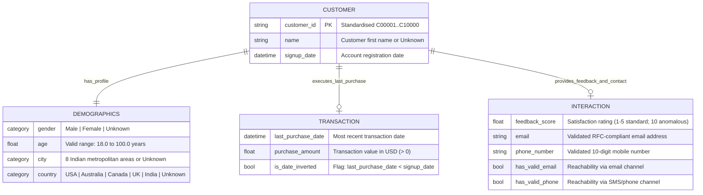

# 🧬 Domain Ontology & Data Contract Specification (`specs/ontology.md`)

**Dataset:** Kaggle — *"Customer Messy Data"* (`data/raw/messy_customer_data.csv`)  
**Cleaned Baseline Artifact:** `data/processed/customers_clean_v1.csv`  
**Total Records:** `10,000` customer rows × `12` raw attributes (`15+` cleaned & engineered attributes)  
**Owner:** Levi Flores (`@levifvy`)

---

## 1. Core Domain Entities & Conceptual Model

The dataset models the commercial lifecycle of retail/e-commerce customers across four interconnected domain entities:

### 1.1 Entity Definitions
1. **`Customer` (Core Identity & Acquisition Entity):**
   - Represents a unique registered account (`customer_id`, `name`, `signup_date`).
   - Primary key `customer_id` is deterministically aligned with the 1-based record index (`C00001` to `C10000`).
2. **`Demographics` (Segmentation & Geographic Entity):**
   - Captures demographic attributes (`gender`, `age`) and geographic location (`city`, `country`) used for market segmentation and cohort profiling.
3. **`Transaction` (Commercial Value & Activity Entity):**
   - Captures monetary spend (`purchase_amount`) and recency (`last_purchase_date`), driving revenue analytics and lifecycle tenure calculations.
4. **`Interaction` (Experience & Omnichannel Reachability Entity):**
   - Captures post-purchase sentiment (`feedback_score`) and direct marketing contactability (`email`, `phone_number`, `has_valid_email`, `has_valid_phone`).

---

## 2. Operational Data Quality Dimensions

All cleaning, auditing (`E2`, `M1`, `A3`, `X4`), and automated unit tests (`X3`) evaluate the dataset across **five formal ISO/DAMA Data Quality Dimensions**:

| Dimension | Operational Definition in This Project | Empirical Baseline in Raw Data (`n = 10,000`) | Target Threshold in `data/processed/` |
|---|---|---|---|
| **1. Completeness** | Proportion of cells containing genuine non-null, non-sentinel information (`1 - (blanks + sentinels) / N`). | Ranges from **`24.65%`** (`Age`) and **`24.66%`** (`purchase_amount`) to **`88.70%`** (`City`). | `100%` structural completeness on categorical keys (via explicit `'Unknown'` category); `100%` documented `NaN` masks on continuous variables. |
| **2. Uniqueness** | Absence of duplicate rows or colliding primary keys (`customer_id`). | `0` exact full-row duplicates; `2,379` blank `CustomerID` cells (`23.79%`) and mixed `'C2'` vs. `'3'` formatting. | **`100.0%` uniqueness** across `customer_id` (`C00001`–`C10000`). |
| **3. Validity** | Conformance of values to syntactic regex patterns, data types, and domain bounds. | Severe corruption: `Age` contains `-5` (`2,506`) and `200` (`2,453`); `purchase_amount` contains `-999` (`2,501`) and `'N/A'` (`2,533`); `Phone_number` contains `'abc123'` (`2,586`) and `'0'` (`2,460`); `email` has `2,422` strings lacking `'@'`. | **`100.0%` type and domain validity** on all non-null values (`18 <= age <= 100`, `purchase_amount > 0`, regex-verified `email` & `phone_number`). |
| **4. Consistency** | Adherence to cross-column logical and chronological invariants. | **Chronological contradiction:** `829` of `1,684` dual-date rows (`49.23%`) have `last_purchase_date < signup_date`. **Geographic contradiction:** All 8 cities are located in India (`Mumbai`, `Delhi`, `Bangalore`, `Hyderabad`, `Pune`, `Chennai`, `Ahmedabad`, `Kolkata`), yet `6,655` rows list `USA`, `Australia`, `Canada`, or `UK` as `Country`. | `100%` flagged via `is_date_inverted` and `is_geo_mismatch` so downstream analyses can filter or compare clean vs. anomalous cohorts. |
| **5. Accuracy** | Degree to which recorded values reflect true underlying customer attributes without scale distortion. | `feedback_score` mixes a `1–5` scale (`2,528` rows) with an anomalous spike at `10` (`2,521` rows) and sentinel `-1` (`2,489` rows). | Dual representation: raw valid `feedback_score` (`1–5` and `10`) plus normalized `feedback_score_1_to_5` and `is_score_10_spike` indicator. |

---

## 3. Variable Dictionary, Sentinel Catalog & Imputation Rules

### 3.1 Core Cleaned Schema (`customers_clean_v1.csv`)

| Raw Column | Cleaned Column (`snake_case`) | Entity | Target Dtype | Plausible Domain / Format | Raw Blanks (`""`) | Sentinel / Corrupted Values in Raw CSV | Valid Raw Rows (`n` / `%`) | Remediation & Imputation Rule (`E3` / `M1`) |
|---|---|---|---|---|---|---|---|---|
| `CustomerID` | `customer_id` | `Customer` | `str` | `^C\d{5}$` (`C00001`–`C10000`) | `2,379` (`23.79%`) | Mixed prefix (`'C2'` vs `'3'`) | `7,621` (`76.21%`) | Reconstruct deterministically as `f"C{row_idx + 1:05d}"` (1-to-1 match with all non-null IDs). |
| `Name` | `name` | `Customer` | `str` | 10 given names (`Rahul`, `Sneha`, `Kiran`, `Ankit`, `Priya`, `Ravi`, `Neha`, `Amit`, `Simran`, `Pooja`) + `'Unknown'` | `1,658` (`16.58%`) | None (whitespace/casing only) | `8,342` (`83.42%`) | Strip whitespace, convert to `.str.title()`, impute blanks as `'Unknown'`. |
| `Gender` | `gender` | `Demographics` | `category` | `{'Male', 'Female', 'Unknown'}` | `2,455` (`24.55%`) | 6 lexical variants: `'Male'` (`1,325`), `'female'` (`1,270`), `'F'` (`1,262`), `'M'` (`1,249`), `'male'` (`1,226`), `'Female'` (`1,213`) | `7,545` (`75.45%`) | Standardize case: map `m`/`male` → `'Male'` (`3,800`), `f`/`female` → `'Female'` (`3,745`), blanks → `'Unknown'` (`2,455`). |
| `Age` | `age` | `Demographics` | `float64` | `[18.0, 100.0]` years (observed valid: `18.0–70.0`, mean `43.7`, median `43.0`, SD `15.3`) | `2,576` (`25.76%`) | `'-5'` (`2,506` rows), `'200'` (`2,453` rows) | `2,465` (`24.65%`) | Coerce `-5` and `200` to `np.nan`. **Do not overwrite `age` with single-value imputation** (which would shrink SD from `15.3` to `7.6`). Provide `age_imputed_median` as an optional auxiliary column when required. |
| `City` | `city` | `Demographics` | `category` | `{'Hyderabad', 'Mumbai', 'Pune', 'Bangalore', 'Chennai', 'Delhi', 'Ahmedabad', 'Kolkata', 'Unknown'}` | `1,130` (`11.30%`) | None | `8,870` (`88.70%`) | Strip whitespace, title-case, impute blanks as `'Unknown'`. |
| `Signup_Date` | `signup_date` | `Customer` | `datetime64[us]` | Observed valid dates `2020-08-06` to `2026-01-26` (`DD/MM/YYYY`); contract: `>= 2020-01-01` and not in the future | `2,529` (`25.29%`) | `'not_a_date'` (`2,475` rows) | `4,996` (`49.96%`) | Replace `'not_a_date'` and `""` with `NaT`; parse via `pd.to_datetime(..., format='%d/%m/%Y', errors='coerce')`. |
| `Last_purchase_date` | `last_purchase_date` | `Transaction` | `datetime64[us]` | Observed valid dates `2020-08-06` to `2026-01-25` (`DD/MM/YYYY`); contract: `>= 2020-01-01` and not in the future | `3,286` (`32.86%`) | `'missing'` (`3,366` rows) | `3,348` (`33.48%`) | Replace `'missing'` and `""` with `NaT`; parse via `pd.to_datetime(..., format='%d/%m/%Y', errors='coerce')`. |
| `purchase_amount` | `purchase_amount` | `Transaction` | `float64` | `(0.0, 10000.0]` USD (observed valid: `$10.31–$4,998.67`, mean `$2,450.62`, median `$2,460.36`, SD `$1,442.83`) | `2,500` (`25.00%`) | `'N/A'` (`2,533` rows), `'-999'` (`2,501` rows) | `2,466` (`24.66%`) | Replace `'N/A'`, `'-999'`, and `""` with `np.nan`. Retain `NaN` in primary `purchase_amount` column to prevent artificial variance compression. |
| `feedback_score` | `feedback_score` | `Interaction` | `float64` | Observed valid values: `{1, 2, 3, 4, 5, 10}` | `2,462` (`24.62%`) | `'-1'` (`2,489` rows); scale jump `'10'` (`2,521` rows vs. `2,528` rows across `1–5`) | `5,049` (`50.49%`) | Coerce `'-1'` and `""` to `np.nan`. Provide both `feedback_score` (`1–5` and `10`) and `feedback_score_1_to_5` (filtering `<= 5`; the `10` spike becomes `NaN`, see §3.2) for robustness checks. |
| `email` | `email` | `Interaction` | `str` | `^[^@\s]+@[^@\s]+\.[^@\s]+$` (`user<N>@mail.com`) | `5,066` (`50.66%`) | `2,422` malformed strings missing `'@'` (e.g., `'user1mail.com'`) | `2,512` (`25.12%`) | Validate against RFC email regex; replace malformed strings and blanks with `np.nan`. Set `has_valid_email = email.notna()`. |
| `Phone_number` | `phone_number` | `Interaction` | `str` | `^\d{10}$` (10-digit mobile number starting with `9`) | `2,444` (`24.44%`) | `'abc123'` (`2,586` rows), `'0'` (`2,460` rows) | `2,510` (`25.10%`) | Validate against `^\d{10}$`; replace `'abc123'`, `'0'`, and blanks with `np.nan`. Set `has_valid_phone = phone_number.notna()`. |
| `Country` | `country` | `Demographics` | `category` | `{'USA', 'Australia', 'Canada', 'UK', 'India', 'Unknown'}` | `1,704` (`17.04%`) | Geographic mismatch with Indian `city` values (`6,655` rows) | `8,296` (`82.96%`) | Standardize string and impute blanks as `'Unknown'`. Track mismatch via `is_geo_mismatch`. |

---

### 3.2 Engineered & Enriched Feature Catalog (`M4`, `A1`, `A2`, `A3`, `A4`)

To support Medium (`M1–M7`) and Advanced (`A1–A7`) analytical milestones, the following standardized features are generated. This table is the **single source of truth** for feature names, labels, and ownership: `AGENTS.md` and every skill must use these exact names and labels. A new feature is added here first, then implemented.

**Ownership rule:** `DataCleanerAgent` owns **data-quality flags** (implemented in `src/cleaning.py`, shipped in `customers_clean_*.csv`). `StatisticalAnalystAgent` owns **analytical features** (implemented in `src/features.py`, shipped in `customers_enriched_*.csv`).

**Label rule:** Every categorical feature is an ordered `category` with an explicit catch-all label for missing source values (`'Unknown'` or `'Missing'`), so `groupby(..., observed=True)` never silently drops rows.

| Feature Name | Owner | Source Columns | Dtype | Formula / Logic | Analytical Purpose |
|---|---|---|---|---|---|
| `has_valid_email` | `DataCleanerAgent` | `email` | `bool` | `email.notna()` | Quantifies email marketing reachability (`25.12%`). |
| `has_valid_phone` | `DataCleanerAgent` | `phone_number` | `bool` | `phone_number.notna()` | Quantifies SMS/telemarketing reachability (`25.10%`). |
| `is_date_inverted` | `DataCleanerAgent` | `signup_date`, `last_purchase_date` | `bool` | `last_purchase_date < signup_date` (`True` for `829` rows) | Flags corrupted chronological records before computing tenure (`E2`, `A3`). |
| `is_geo_mismatch` | `DataCleanerAgent` | `city`, `country` | `bool` | `(city != 'Unknown') & (country.isin(['USA', 'UK', 'Canada', 'Australia']))` | Audits cross-column geographic contradiction where Indian cities are paired with non-Indian countries (`A3`). |
| `is_age_missing` | `DataCleanerAgent` | `age` | `bool` | `age.isna()` (blank or sentinel) | Missingness indicator; lets analyses compare known vs. unknown age cohorts without imputing (`M1`). |
| `is_purchase_missing` | `DataCleanerAgent` | `purchase_amount` | `bool` | `purchase_amount.isna()` (blank or sentinel) | Missingness indicator for spend (`M1`). |
| `is_score_10_spike` | `DataCleanerAgent` | `feedback_score` | `bool` | `feedback_score == 10` | Isolates the off-scale `10` rating anomaly (`A3`). |
| `feedback_score_1_to_5` | `DataCleanerAgent` | `feedback_score` | `float64` | `feedback_score.where(feedback_score <= 5)` — the `10` spike becomes `NaN` (**not** remapped to `5`, which would inflate Promoters by `2,521` rows) | Clean Likert-scale rating for satisfaction statistics (`Q3`). |
| `completeness_score` | `DataCleanerAgent` | All 12 raw columns | `float64` | Row-wise proportion of valid (non-null, non-sentinel) attributes (`0.0` to `1.0`) | Quantifies record-level data quality for `reports/data_quality_report.md` (`X4`). |
| `age_group` | `StatisticalAnalystAgent` | `age` | ordered `category` | `pd.cut(age, bins=[17, 29, 44, 59, 100], labels=['18-29 (Young Adult)', '30-44 (Early Career)', '45-59 (Mid-Senior)', '60+ (Senior)'])`, then missing `age` → `'Unknown'` (last category) | Enables demographic cohort aggregation and bivariate spend comparison (`E5`, `M3`, `M4`). |
| `spend_tier` | `StatisticalAnalystAgent` | `purchase_amount` | ordered `category` | Fixed business thresholds (not quantiles): `< 1200` → `'Low (<$1,200)'`; `1200 <= x <= 3500` → `'Medium ($1,200-$3,500)'`; `> 3500` → `'High (>$3,500)'`; missing → `'Missing'` | Identifies high-value VIP customer concentration (`Q2`, `M4`). |
| `feedback_tier` | `StatisticalAnalystAgent` | `feedback_score` | ordered `category` | `1-2` → `'Detractor (1-2)'`; `3` → `'Passive (3)'`; `4-5` → `'Promoter (4-5)'`; `10` → `'Scale-10 Spike (10)'`; missing → `'Missing'` | Separates standard Likert ratings (`1–5`) from the `10` rating anomaly (`M4`, `A3`). |
| `contact_reachability_tier` | `StatisticalAnalystAgent` | `has_valid_email`, `has_valid_phone` | ordered `category` | `'Omnichannel (Both)'`, `'Email Only'`, `'Phone Only'`, `'Unreachable (None)'` | Segments customers by operational campaign reachability (`Q3`). |
| `customer_tenure_days` | `StatisticalAnalystAgent` | `signup_date`, `last_purchase_date` | `float64` | `(last_purchase_date - signup_date).dt.days` where `~is_date_inverted` (`else np.nan`) | Measures active lifecycle duration in days for valid chronological cohorts (`M4`, `M6`). |
| `log_purchase_amount` | `StatisticalAnalystAgent` | `purchase_amount` | `float64` | `np.log1p(purchase_amount)` | Stabilizes right-skewed or wide-range monetary scale for parametric modeling (`A4`). |
| `metro_region` | `StatisticalAnalystAgent` | `city` + `data/external/indian_cities_metadata.csv` | ordered `category` | Mapped via auxiliary Indian Metro catalog: `'West'`, `'North'`, `'South'`, `'East'`, `'Unknown'` | Enables regional macroeconomic and geographic cohort analysis (`A2`, `A5`). |
| `metro_state` | `StatisticalAnalystAgent` | `city` + `data/external/indian_cities_metadata.csv` | `category` | State/territory lookup: `'Maharashtra'`, `'Delhi (NCR)'`, `'Karnataka'`, `'Telangana'`, `'Tamil Nadu'`, `'West Bengal'`, `'Gujarat'`, `'Unknown'` | State-level segmentation and spatial join verification (`A2`). |
| `metro_population_m` | `StatisticalAnalystAgent` | `city` + `data/external/indian_cities_metadata.csv` | `float64` | Metro agglomeration population in millions from Census/demographic lookup; `np.nan` for `'Unknown'` | Enables demographic size weighting and per-capita normalization (`A2`). |

---

## 4. Business KPIs, Metrics & Research Question Mapping

Every statistical table, chart, and executive conclusion must anchor to the following canonical KPIs:

| KPI ID | Metric Name | Mathematical Definition | Baseline Value (`customers_clean_v1.csv`) | Mapped Business Question |
|---|---|---|---|---|
| **KPI-1** | **Valid Attribute Coverage Rate (%)** | $\frac{N_{\text{valid}}(X)}{10,000} \times 100$ | `age`: `24.65%`, `purchase_amount`: `24.66%`, `feedback_score`: `50.49%`, `city`: `88.70%` | **Q1 / Data Quality Audit** |
| **KPI-2** | **Mean & Median Order Value (AOV / MOV)** | $\bar{x}_{\text{spend}} = \frac{1}{n}\sum x_i$, $\quad \tilde{x}_{\text{spend}} = Q_2(x)$ | Mean: **`$2,450.62`** (`SD = $1,442.83`), Median: **`$2,460.36`** (`IQR = $2,574.50`, $n = 2,466$) | **Q2 — Revenue Distribution** |
| **KPI-3** | **Normalized Segment Revenue per 1,000 Customers** | $\frac{\sum_{i \in S} \text{purchase\_amount}_i}{n_{\text{valid\_spend}, S}} \times 1,000$ | Eliminates sample-size bias when comparing `gender`, `age_group`, `city`, or `country` (`A1`). | **Q2 — High-Value Segments** |
| **KPI-4** | **Omnichannel Reachability Rate (%)** | $\frac{\sum \mathbb{I}(\text{has\_valid\_email} \lor \text{has\_valid\_phone})}{10,000} \times 100$ | Email valid: `25.12%`, Phone valid: `25.10%`, At least one valid channel: **`43.88%`** (`4,388` customers; `634` / `6.34%` both; `5,612` / `56.12%` unreachable) | **Q3 — Retention & Reachability** |
| **KPI-5** | **Chronological Integrity Rate (%)** | $\frac{\sum \mathbb{I}(\text{last\_purchase\_date} \ge \text{signup\_date})}{N_{\text{both\_dates}}} \times 100$ | **`50.77%`** valid (`855` valid vs. `829` inverted out of `1,684` dual-date records) | **Q3 — Lifecycle & Tenure** |
| **KPI-6** | **Net Satisfaction Distribution (`1–5` vs. `10`)** | Share of valid ratings across Detractors (`1–2`), Passives (`3`), Promoters (`4–5`), and `10` anomaly | `1–5` scale: `2,528` rows (`mean = 2.96`); `10` spike: `2,521` rows (`49.93%` of valid ratings) | **Q3 — Customer Satisfaction** |
